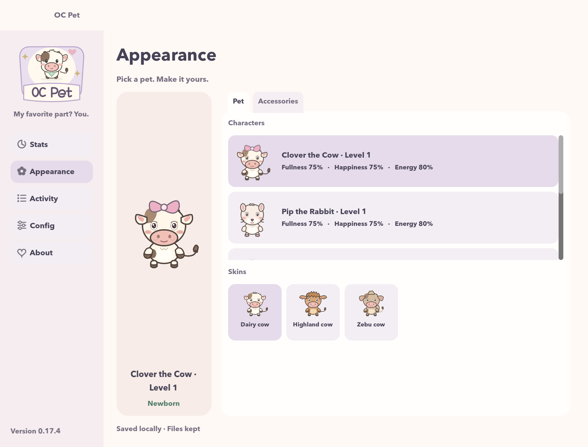

# OC Pet

**A little company. A happier desktop.**

OC Pet is a desktop companion for macOS and Windows. Meet Clover the Cow, Pip the Rabbit, Mochi the Otter, Biscuit the Dog, and Miso the Cat: five little personalities that grow alongside your day.

[Visit the website](https://hotrungnhan.github.io/oc-pet-website/) · [Download OC Pet](https://github.com/hotrungnhan/oc-pet-website/releases) · [Report a bug](https://github.com/hotrungnhan/oc-pet-website/issues)



## Meet your desktop friend

- Five species, 15 breed variants, and ten growth appearances per pet.
- Feed, share affection, and keep independent progress for each companion.
- Little stretches, naps, foraging moments, football, and basketball.
- Adjustable size, sound, timed hide/mute, and click-through controls.
- English and Vietnamese interfaces. Progress and settings are saved locally; no account is required.

**File drops:** by default, dropping a valid regular file on the pet moves it to Trash / Recycle Bin. Disable file cleanup in Config for pretend snacks that keep originals.

## Install

Get the installer for your platform from [GitHub Releases](https://github.com/hotrungnhan/oc-pet-website/releases). macOS and Windows releases may have different versions; the website finds the newest published installer for each platform.

- **macOS:** open the `.dmg` and drag OC Pet into Applications. Builds are unsigned and not notarized; review the release notes before installing.
- **Windows:** run the `-setup.exe` installer. Saved pets are retained on uninstall.

These are development builds. Windows hardware validation is still in progress. Report problems with your app version and operating system in Issues.

## Website development

This public repository contains the **React + Vite landing page**, screenshots, original character images, and public app releases. The desktop app is developed in a separate repository.

Requires Node.js 24 and npm.

```sh
npm ci
npm run dev
npm test
npm run build
npm run preview
```

Website content is in `src/main.jsx`, styling in `src/style.css`, and images in `public/images/`. Download discovery is in `src/releases.js`. It uses GitHub’s public releases API without credentials, excludes drafts/prereleases, and falls back to the Releases page if the API is unavailable or rate limited.

## GitHub Pages

Pushes to `main` run `.github/workflows/deploy.yml`: install locked dependencies, test release selection, build the site, and deploy `dist/` to GitHub Pages. Pages must use **GitHub Actions** as its publishing source. `vite.config.js` sets the project path to `/oc-pet-website/`; update it and the metadata in `index.html` if you rename the repository or add a custom domain.

Deployment follows [Vite’s GitHub Pages guide](https://vite.dev/guide/static-deploy#github-pages) and [GitHub’s custom workflow documentation](https://docs.github.com/en/pages/getting-started-with-github-pages/using-custom-workflows-with-github-pages).

## Publishing app updates

Publish a non-prerelease GitHub Release in this repository and attach `OCPet-<version>.dmg` and/or `OCPet-<version>-setup.exe`. The website discovers published installers on page load; no website rebuild is needed. Include checksums and platform notes with each release. A release containing only one platform leaves the other platform on its most recent available installer.

Example (run from the website repository, adjusting paths):

```sh
gh release create v0.18.0 /path/to/OCPet-0.18.0.dmg /path/to/OCPet-0.18.0-setup.exe --title 'OC Pet 0.18.0' --notes-file /path/to/release-notes.md
```

## License

Website code is MIT. Original OC Pet character artwork is CC0-1.0; see [image attribution](public/images/LICENSE.md). The app screenshot is included to demonstrate OC Pet. External fonts are served by Google Fonts (DM Sans and Lora, SIL Open Font License).
