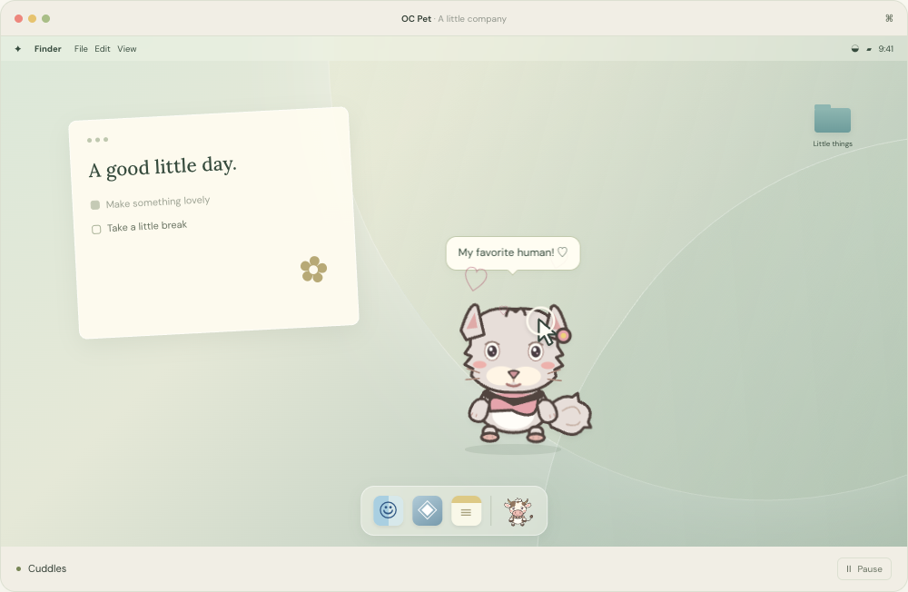
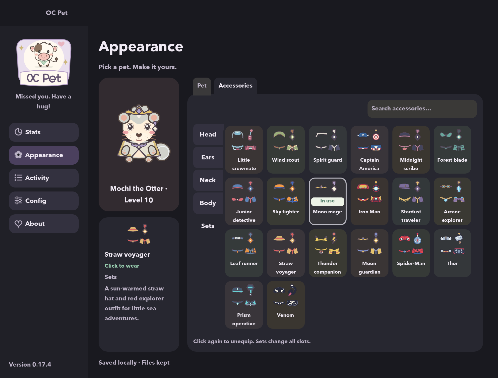

# OC Pet


**A little company. A happier desktop.**

Five desktop friends. Fifteen skins. Little outfits, cuddles, snacks, and playtime. Make your Mac or Windows desktop a little cozier.

[Try the interactive website](https://hotrungnhan.github.io/oc-pet-website/) · [Download](https://github.com/hotrungnhan/oc-pet-website/releases) · [Report a bug](https://github.com/hotrungnhan/oc-pet-website/issues)

- Meet Clover, Pip, Mochi, Biscuit, and Miso.
- Switch skins and dress up with outfits and accessories.
- Feed, pet, play football or basketball, and grow together.
- English & Tiếng Việt. No account needed.



[Explore the animated desktop demo →](https://hotrungnhan.github.io/oc-pet-website/#desktop-title)

Cuddles, snack time, catch & drag, football, basketball, and quiet naps. Pick a scene or grab your little friend inside the Mac-style frame.

<details>
<summary>A peek inside the wardrobe</summary>



</details>

Made by **Young Boy Studio** · [@hotrungnhan](https://github.com/hotrungnhan). Some assets may become paid in the future. Thank you for supporting this little project. ♡

## Install

Get the latest installer from [Releases](https://github.com/hotrungnhan/oc-pet-website/releases). On macOS, open the `.dmg` and drag OC Pet into Applications. On Windows, run the `-setup.exe` installer. macOS builds are unsigned and not notarized; Windows hardware validation is ongoing.

File drops move files to Trash / Recycle Bin by default. Turn off file cleanup in Config to keep originals.

## Website development

This public repository contains the **React + TypeScript + Vite + Tailwind CSS landing page**, screenshots, original character images, and public app releases. The desktop app is developed in a separate repository.

Requires Node.js 24 and npm.

```sh
npm ci
npm run dev
npm test
npm run build
npm run preview
```

Website content is in `src/main.tsx`, styling in `src/style.css`, and images in `public/images/`. Download discovery is in `src/releases.ts`. It reads GitHub’s public releases API without credentials, excludes drafts/prereleases, and selects installers independently per platform. Responses and ETags are cached in localStorage for 15 minutes. Expired entries are revalidated with If-None-Match; saved downloads remain usable if GitHub is offline or rate limited. Checks run on page load, every 15 minutes while visible, and when the browser regains focus or goes online. If storage is blocked, downloads still work without caching. Without cached data, failures fall back to the Releases page.

The layout uses Tailwind CSS 4 through `@tailwindcss/vite`, following the [current Vite setup](https://tailwindcss.com/docs/installation/using-vite). Theme colors are CSS variables in `src/style.css`. Dark mode follows the system on first visit; the theme toggle persists the visitor’s preference. The landing page includes an animated Mac-style desktop with six illustrative interaction scenes, scene selection, pause/play, and pointer dragging. It uses the original pet artwork and CSS animation; it is labeled as an animated preview. Scene cycling pauses offscreen and defaults off for reduced-motion preferences. The hero has 15 actual skin previews and pet/feed/play reactions. An expandable section holds the three-image app settings gallery and native-dialog lightbox. Motion respects the reduced-motion preference. An OS-aware split download button sits in the hero. Its chevron lists other platforms. Linux/mobile/unknown platforms show Unsupported while retaining the platform menu. Supported platforms without a published installer show Coming soon rather than an invented download URL. English/Vietnamese copy is in `src/i18n.ts`; the language selector persists the choice and keeps it in navigation URLs. OS detection is in `src/platform.ts`.

## GitHub Pages

Pushes to `main` run `.github/workflows/deploy.yml`: install locked dependencies, test release selection, build the site, and deploy `dist/` to GitHub Pages. Pages must use **GitHub Actions** as its publishing source. `vite.config.ts` sets the project path to `/oc-pet-website/`; update it and the metadata in `index.html` if you rename the repository or add a custom domain.

Deployment follows [Vite’s GitHub Pages guide](https://vite.dev/guide/static-deploy#github-pages) and [GitHub’s custom workflow documentation](https://docs.github.com/en/pages/getting-started-with-github-pages/using-custom-workflows-with-github-pages).

## Automated app releases

The private app repository has a tag-triggered release workflow. A matching `vMAJOR.MINOR.PATCH` tag builds and tests both installers on a macOS GitHub runner, then publishes them here with SHA-256 checksums. No website rebuild is needed. Manual workflow runs build artifacts for validation without publishing a release. See `docs/RELEASING.md` in the app repository for credential setup and tagging instructions.

## Publishing app updates

Publish a non-prerelease GitHub Release in this repository and attach `OCPet-<version>.dmg` and/or `OCPet-<version>-setup.exe`. The website discovers published installers on page load; no website rebuild is needed. Include checksums and platform notes with each release. A release containing only one platform leaves the other platform on its most recent available installer.

Example (run from the website repository, adjusting paths):

```sh
gh release create v0.18.0 /path/to/OCPet-0.18.0.dmg /path/to/OCPet-0.18.0-setup.exe --title 'OC Pet 0.18.0' --notes-file /path/to/release-notes.md
```

## License

Website code is MIT. Original OC Pet character artwork is CC0-1.0; see [image attribution](public/images/LICENSE.md). The app screenshot is included to demonstrate OC Pet. External fonts are served by Google Fonts (DM Sans and Lora, SIL Open Font License).

## Release-note template

For manual releases, copy [the release template](.github/RELEASE_TEMPLATE.md) into the release description and replace `{{VERSION}}` and `{{CHANGES}}`. Automated releases render the app repository’s copy of this template using public change notes from `docs/releases/<version>.md` before publishing. The template includes installer details, checksum commands, platform limitations, and the maker’s note.

## Optional app analytics

Analytics-capable desktop releases ask for consent before initializing GameAnalytics. Not now or closing the dialog keeps it off. Config can disable it later; restarting is required to enable again after shutdown. Reports use pseudonymous random installation IDs, not complete anonymity. GameAnalytics receives usage/session, platform/device and connection/IP information. OC Pet does not send names, files, file contents, foreground app names, or account details. Previously queued events may finish during shutdown. See the [website Privacy page](https://hotrungnhan.github.io/oc-pet-website/privacy.html). The website itself does not load GameAnalytics. Studio branding is separate from the CC0 character library.

## Terms and Privacy pages

`terms.html` and `privacy.html` are real static entry points in the Vite multi-page build, sharing the React shell and English/Vietnamese translations. Their content is owned by Young Boy Studio; the provider policy is only a reference inside our Privacy page. Each page can be linked directly and refreshed on GitHub Pages. Update legal copy in `src/i18n.ts` when app behavior, asset licensing, or data handling changes.
